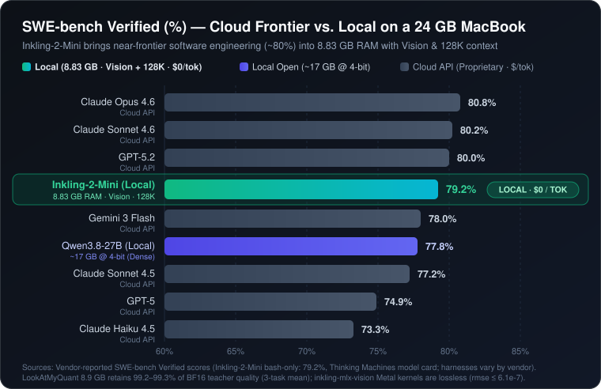
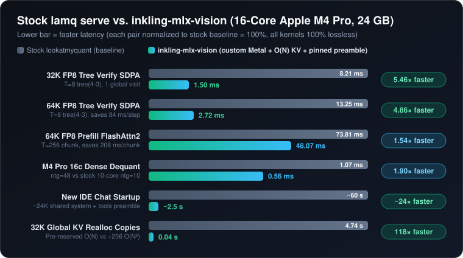

# inkling-mlx-vision

**Cloud-tier coding & vision intelligence (`79.2%` SWE-bench Verified) — running 100% locally on a 16–24 GB MacBook in `8.83 GB` RAM.**

`inkling-mlx-vision` turns [LookAtMyQuant](https://github.com/ShinMegamiBoson/lookatmyquant)'s ultra-compressed **Inkling-2-Mini** into a **fast, multimodal, 128K-context OpenAI server** for local AI coding agents (**ZCode, Cline, Continue, Pi, OpenAI SDK**) on Apple Silicon.

Zero PyTorch. Zero edits to `lookatmyquant`. 100% lossless custom Apple Silicon Metal kernels (`rmse ≤ 6.1e-7`).

---

## Why This Matters: Near-Frontier Cloud Quality, Running Locally



Thinking Machines' **Inkling-2-Mini** (Apache 2.0) is a **26.4B looped Mixture-of-Experts (MoE)** model whose 12 middle layers loop 3 times per token (`48` logical layers, ~3.4B unique / ~5.4B effective active parameters). On the maintainers' published coding evaluations, it sits right next to flagship cloud APIs — and beats much larger open-weight models:

| Official Benchmark *(Thinking Machines model card)* | **Inkling-2-Mini** *(26.4B MoE · Local 8.83 GB)* | Qwen3.8-27B *(27B Dense)* | Nemotron 3.5 Super VL *(125B)* | Gemma 4 31B *(31B Dense)* |
|---|---:|---:|---:|---:|
| **SWE-bench Verified** *(bash only)* | **79.2%** | 77.8% | — | — |
| **SWE-bench Pro v2 (Hard)** | **77.9%** | 73.8% | 44.1% | 14.2% |
| **DeepSWE v1.1** | **48.2%** | 42.2% | 24.7% | 0.3% |
| **Terminal Bench v2.1** | **71.6%** | 73.0% | 60.7% | 43.4% |

- [LookAtMyQuant](https://github.com/ShinMegamiBoson/lookatmyquant)'s **8.9 GB** build retains **99.2%–99.3%** of the untouched BF16 teacher's quality (3-task mean) while shrinking weights + 4-bit drafter to **8.83 GB**.
- `inkling-mlx-vision` unlocks **native Vision**, **custom Metal SDPA/FA2 kernels** (zero quality loss, `rmse ≤ 6.1e-7`), **128K context stability**, and **2–3s chat starts** — so tasks that previously needed paid cloud APIs or a **36–64 GB Mac / 24 GB+ GPU rig** now run privately on an everyday **24 GB MacBook** alongside macOS, your IDE, Docker, and Chrome.

### How It Compares by Specs on a 24 GB MacBook

| Model / Setup | Architecture & Active Params | Vision | Speculative Drafter | Weight RAM | Context | Reality on a **24 GB Mac** *(with macOS + IDE + browser)* |
|---|---|---|---|---:|---|---|
| **Cloud APIs** *(Claude 4.6 / GPT-5.2 / Gemini 3)* | Frontier cloud | Yes | Server-side | 0 GB *(paid $/tok)* | 200K–1M | Requires internet, sends code to cloud, recurring API cost |
| **`Inkling-2-Mini` (`LAMQ 8.9GB`) + `inkling-mlx-vision`** | **26.4B Looped MoE** (~3.4B unique / ~5.4B eff. active) | **Yes** *(0 GB idle via lazy mmap)* | **Yes** *(DSpark 3L, up to 8 tok/step)* | **8.83 GB** | **128K+** *(1M native)* | **Comfortable at 64K–128K** (~11–13 GB active, ~10+ GB free, **25–45+ tok/s**) |
| **Qwen3.8-27B / Qwen3.5-27B** *(4-bit)* | 27B Dense *(27B active)* | Yes | No | ~16.5–17 GB | 128K–262K | **Tight & slower** (dense 27B bandwidth limit; swaps on long agent chats) |
| **Qwen3-Coder-30B-A3B** *(4-bit)* | 30.5B MoE *(3.3B active)* | No *(text-only)* | No | ~17.2 GB | 256K | **Very tight** (19–22 GB even at short context; no screenshot input) |
| **Gemma 3 27B** *(4-bit)* | 27B Dense *(27B active)* | Yes | No | ~17.0 GB | 128K | **32 GB+ recommended** (heavy swap alongside IDE + Chrome) |
| **Qwen2.5-VL-7B** *(4-bit)* | 8.3B Dense *(8.3B active)* | Yes | No | ~5.0 GB | 128K | **Easy fit**, but 7B-class coding & reasoning capacity |

---

## Before vs. After: What Was Missing in Stock `lamq serve` — and What We Built



### The Starting Point

Out of the box, `lookatmyquant`'s `lamq serve` already delivered remarkable compression (`8.83 GB` + 4-bit DSpark drafter), **but plugging it into a real coding IDE (ZCode, Cline, Continue) hit four walls:**
1. **Text-only:** every screenshot sent by your IDE was stripped (`[image omitted: this server is text-only]`).
2. **Long-context bottlenecks on M4 Pro / Max:** stock `T=2..8` DSpark verify SDPA ran scalar loops instead of Apple Silicon's `simdgroup_half8x8` matrix units; 16+ core M4 Pro/Max GPUs were throttled by 10-core base M4 grids; and Global KV buffers reallocated every `+256` tokens (`O(N²)` copy storms at 32K–128K).
3. **~60-second cold starts on every new IDE chat:** coding agents send ~24K tokens of system prompt + tools on every new thread, and tiny auto-title requests evicted active chats from the prompt cache.
4. **Agent instability:** parallel IDE requests hit `HTTP 503 model is busy`, long tool-call buffering triggered SSE idle timeouts, and occasional quantized FP8 tool-call JSON typos (`{"name":"read_file"args":{...}}`) or repetition loops could stall a turn.

### What `inkling-mlx-vision` Adds

1. **Native Pure-MLX Vision Tower (`0.00 GB` RAM tax on text turns)**
   - Faithful pure-MLX implementation of Hugging Face `Inkling2ImageProcessor` + 23-layer BF16 `Inkling2VisionModel` (Retina/4K aspect-preserving scaling, RGBA checkerboard compositing, axial 2D RoPE, `2×2` spatial merger).
   - **637 MB HTTP-Range extractor (`inkling-extract-vision`):** fetches *only* the 422 `vision_tower.*` tensors from Hugging Face without downloading the 16.9 GB full checkpoint.
   - **Lazy on-demand mmap (~21 ms):** loads vision weights only when an image arrives and releases them before LLM prefill starts.
   - **Image-hash-safe KV cache:** follow-up turns on the same screenshot take **0 ms ViT**, and two different screenshots of identical resolution never collide.

2. **Custom Apple Silicon Metal Kernels & O(N) Engine (`accel.py`) — 100% Lossless**
   - **GQA-Shared Split-K `simdgroup_half8x8` SDPA (`T=2..8`):** 3 GQA heads share one `BK=32` K/V tile load via hardware `simdgroup_multiply_accumulate` — **4.47×–5.46× faster** on DSpark block & tree verify at 32K–64K context (`rmse ≤ 6.1e-7`).
   - **Lean-SRAM GQA-Shared FlashAttention-2 (`BQ=32, BK=32`, 15.6 KB SRAM):** **1.38×–1.54× faster** long-context prefill (`rmse ≤ 5.3e-8`).
   - **DSpark Drafter GQA-12:1 Split-K SDPA (`T=2..8`):** replaces Apple MLX's built-in `mx.fast.scaled_dot_product_attention` across all 3 drafter layers (local `1K` and global `16K–128K`) with zero slice copies — **4.7×–6.5× faster** (`21.66 ms → 3.32 ms` at 128K, `rmse ≤ 3.2e-6`), plus `B_len` trimming for `temp > 0`.
   - **Exact 3-Pass Radix-Histogram `top_p` Metal Kernel:** eliminates 200K/32K `mx.argsort` on every `temp > 0, top_p < 1` round — **5.7× faster** (`2.36 ms → 0.42 ms`, `rmse = 7.2e-11`) with zero CPU sync, plus lossless `NgramDraftIndex` (`min_match=5`) enabled by default with **incremental `O(delta)` cross-turn reuse**.
   - **Exact SpecInfer Stochastic Tree Verification (`spec.py`, opt-in `LAMQ_STOCHASTIC_TREE=auto|4-3`):** unlocks 8-node `"4-3"` tree verification at `temp > 0, top_p < 1` via sequential-residual multi-draft rejection sampling with without-replacement root splitting (`q_b1 = norm(q_a1 · 1[x ≠ a1])`), running the entire tree walk on GPU so the `[200,058]` residual categorical draw executes only **once** (`1.32 ms` vs `1.39 ms` for 1D verify, 100% unbiased target distribution). Opt-in so default `temp > 0` decoding keeps zero-copy O(1) `commit_spec_verify` on long shared-KV contexts.
   - **Hybrid `N-Gram / Token Recycling || DSpark` Split-Source Tree (`spec.py`):** fuses medium-confidence 3/4-gram matches or verified per-session `TokenRecycler` bigrams onto Branch A (`nodes 1..4`) while DSpark populates Branch B (`nodes 5..7`, only 3 drafter head calls) — verifying both in a single 8-node tree forward pass, with optional DSpark Markov-state carryover (`LAMQ_MARKOV_CARRY=1`).
   - **MoE Prefill v4 (`moe_v4.py`, `tile_t = 32/48/64`, 9.1 KB SRAM, Fused `GU → SwiGLU` + NVFP4-Skipping `RHT-1152`, bit-exact `max_diff == 0.0`):** sizes the threadgroup LUT union to exact per-layer needs (`4 KB` for HT, `1.5 KB` for NVFP4 with a 256-entry `half2` byte-pair LUT `tg_e2m1_p`, `8 KB` only when RTR1–3 is present), streams weights with per-`j` `A0/A1` registers (2 regs + 1 `Xm` reg, zero register spilling up to `tile_t = 64` inside **`9.1 KB` SRAM → 3 threadgroups/core** on M4 Pro), fuses `GU → Softcapped SwiGLU` in registers (`sorted_out=True` → `sorted_in=True`, eliminating the `[n_slots, 2304] f32` `y_gu` buffer and saving `-50..80 MB` peak RAM), and skips `H_16 + Paley-72` completely on all 19 pure-NVFP4 `dn` visits (and NVFP4 experts on 23 mixed visits) — pushing end-to-end 48-visit `12.8GB` prefill to **`385.0 tok/s` (`T=256`, `+7.0%` over v3)**, **`418.9–430.5 tok/s` (`T=512`)**, and **`431.0–446.0 tok/s` (`T=1024`, `+26–30%` over stock)** with **`max_diff == 0.0`**. Also includes an opt-in 2-slot parallel `SwiGLU + Paley-72 RHT-1152` Metal kernel (`LAMQ_PAR_SWIGLU=1`, `max_diff == 0.0`) and a standalone Quest L1-bounding-box KV page scoring Metal kernel (`quest.py`, `0.14 ms` at 64K / `0.17 ms` at 128K).
   - **16+ Core M4 Pro / Max Grid Tuning (`applegpu_g16s/c/d`):** removes 10-core base M4 throttling across `DenseStage` (**1.20×–1.90×**), `UnifiedMoESide` (**1.17×–1.76×**), and `T=1` Split-K SDPA (`48` splits).
   - **O(N) Global KV Pre-allocation + Zero-Copy Shared Global KV + Sliding-Window Trim (`W=1024`):** replaces `+256` reallocations with `4096`-step `_reserve_cap` (**118×** less KV copy overhead at 32K), shares append-only global KV buffers zero-copy between active generation and stored chat snapshots (**saves ~1.0–2.0 GB active RAM**), and trims 40 sliding KV slots back to `W=1024` on snapshot store.

3. **Agent-IDE Production Hardening & SOTA Cache Orchestration**
   - **3-Tier Post-Generation KV Cache Promotion (`post_gen → pre_tool_gen → base`):** promotes the live KV cache at the end of `<|content_thinking|>` reasoning (`pre_tool_gen`) and at the end of the turn (`post_gen`), so follow-up agent turns reuse 100% of the model's generated thinking and tool-call tokens without re-prefilling them.
   - **Persistent Disk-Backed `pinned-sys` Snapshot (`~/.cache/inkling-mlx-vision/pinned_sys.safetensors`):** automatically detects shared `system` + `tools` + leading `<system-reminder>` blocks (~24K tokens), pins 1 shared snapshot in RAM (**~2–3s** new chat start), and persists it to disk so **cold starts after a server restart drop from ~60–90s to ~0.2–0.4s**.
   - **24 GB Unified Memory OOM & Anti-Swap Hardening for `12.8GB` (100% BF16-Fidelity) Build:** safely runs the `12.8GB` variant past 54K+ context with multimodal screenshots on a 24 GB Mac via a **zero-allocation pre-tokenization char gate** (rejects overflowing `> ctx * 7` char payloads in `<0.1 ms` before BPE), early post-BPE context overflow rejection, zero-overhead bypass mode (skips `+1.89 GB` `loop_w_cache` above `12.5 GiB` or on short bypass queries), safe `mx.set_wired_limit` clamping, pre-clone layer-by-layer ViT evaluation with automatic CPU fallback, cost-aware pre-eviction & side-query protection, and in-place `move_hit` rollback on abort.
   - **Fair FIFO queue + continuous SSE keepalive:** eliminates `HTTP 503` errors and client idle timeouts during long tool calls.
   - **Tool-call resilience, fuzzy tool-name resolution & guards:** auto-repairs quantized tool JSON missing `,"` before `args`/`arguments`, canonicalizes snake_case/lowercase/synonym tool names (`bash`/`run_command` → `Bash`, `read_file` → `Read`, `todo_write` → `TodoWrite`) against the request's `tools` schema, reports accurate live generation `tok/s`, and cleanly aborts runaway 256-token repetition loops or stuck `discard_tool` states.

| Capability / Bottleneck *(16-Core M4 Pro, 24 GB)* | Stock `lamq serve` | `inkling-mlx-vision` | Gain |
|---|---|---|---|
| **Vision (screenshots / UI / tool images)** | Text-only | Native BF16 MLX ViT (0 GB idle) | **Full multimodal** |
| **Follow-up turn on cached screenshot** | N/A | **0 ms ViT**, instant KV reuse | **Zero ViT re-encode** |
| **New agent chat (~24K sys/tools preamble)** | ~60s prefill every chat | **~2–3s** (RAM) / **~0.2s** (disk cache after restart) | **~24×–300× faster start** |
| **Generated thinking + tool-call tokens on next turn** | Re-prefilled from scratch | **0 ms prefill** (3-tier `post_gen`/`pre_tool_gen` KV promotion) | **Instant turn handoff** |
| **48-visit 12.8GB Prefill (`1024` tokens)** | 2,990 ms (`342.5 tok/s`, `chunk=256`) | **2,296–2,376 ms (`431–446 tok/s`)** (MoE v4 `tile_t=64` + fused `GU→SwiGLU`) | **+26%–30% faster** (`max_diff 0.0`) |
| **32K / 64K FP8 `T=8` tree(`4-3`) verify SDPA** | 8.21 ms / 13.25 ms | **1.50 ms / 2.72 ms** (`rmse 4–6e-7`) | **5.46× / 4.86× faster** |
| **64K FP8 `T=256` prefill FA2** | 73.81 ms / visit | **48.07 ms** / visit (`rmse 2.7e-8`) | **1.54× faster** (`-206 ms`/chunk) |
| **32K Global KV reallocation copies** | 4.74 s (`+256` step) | **0.04 s** (pre-reserved `4096`) | **118× less overhead** |
| **Multi-turn chat KV copies** | 2 clones / turn | **Zero-copy shared global KV** (in-place move + shared store) | **Saves ~1.0–2.0 GB RAM** |
| **Concurrent IDE requests (chat + title)** | `HTTP 503` + eviction | FIFO queue + short-prompt bypass | **Zero dropped requests** |
| **FP8 tool-call JSON typo / loop stalls** | Tool dropped / hangs | Auto-repaired + loop & keepalive guards | **Reliable agent loops** |

---

## Quickstart

Requires **macOS on Apple Silicon (M1/M2/M3/M4)**.

### One-Command Install (Recommended)

Installs `uv` (if needed), creates an isolated Python 3.12 `.venv`, installs `lookatmyquant` + `inkling-mlx-vision`, extracts the 637 MB `vision_tower.safetensors` via HTTP Range, auto-selects the right quant for your Mac's Unified Memory (`8.9GB` on 16–24 GB Macs, `12.8GB` on 32+ GB Macs), and installs the `inkling-server` launcher:

```zsh
curl -fsSL https://raw.githubusercontent.com/qoder3/inkling-mlx-vision/main/install.sh | bash
```

Optional flags (pass after `bash -s --`):

```zsh
# Pick the 100% BF16-fidelity 12.8GB build and start the server immediately:
curl -fsSL https://raw.githubusercontent.com/qoder3/inkling-mlx-vision/main/install.sh | bash -s -- --variant 12.8GB --start

# Other useful flags: --dir PATH, --port 8080, --kv fp8|q4, --no-vision, --run-tests, --dry-run
```

Then start (or restart) anytime without activating a virtualenv:

```zsh
inkling-server --restart
# or: ~/inkling-mlx-vision/scripts/start_server.sh --restart
```

<details>
<summary><strong>Manual Step-by-Step Install</strong></summary>

#### 1. Install

```zsh
git clone https://github.com/qoder3/inkling-mlx-vision.git
cd inkling-mlx-vision
./install.sh   # or run the commands below manually:
uv venv --python 3.12
source .venv/bin/activate
uv pip install "git+https://github.com/ShinMegamiBoson/lookatmyquant.git"
uv pip install -e .
```

#### 2. Extract `vision_tower.safetensors` (~637 MB)

Downloads **only** the 637 MB vision weights from Hugging Face via HTTP Range requests (skips the 16.9 GB LLM shards):

```zsh
inkling-extract-vision -o vision_tower.safetensors
```

*(Already have `Inkling-2-Mini-oQ4e-mtp` locally? Extract offline in `<0.5s`:)*

```zsh
inkling-extract-vision --from-local /path/to/Inkling-2-Mini-oQ4e-mtp -o vision_tower.safetensors
```

#### 3. Start the Server

```zsh
LAMQ_GLOBAL_KV=fp8 inkling-mlx-serve \
  shinmegamiboson/Inkling-2-Mini-LookAtMyQuant-8.9GB \
  --drafter shinmegamiboson/Inkling-2-Mini-LookAtMyQuant-drafter \
  --vision ./vision_tower.safetensors \
  --host 127.0.0.1 --port 8080 \
  --model-id inkling-2-mini \
  --context 131072 --max-tokens 16384 \
  --prompt-cache 3 --prefill-chunk 512 \
  --reasoning-effort medium --temp 0.6 --top-p 0.95
```

Or use the included launcher script (auto-detects `.venv`, supports `--restart`, `.inkling.env`, and env overrides like `MODEL_VARIANT=12.8GB` or `LAMQ_GLOBAL_KV=q4`):

```zsh
./scripts/start_server.sh --restart
```

</details>

On startup you should see:
```text
metal accel enabled: GQA-SG8 SDPA + GQA-FA2 + DSpark-GQA12 SDPA + Radix-TopP + MoE-v4-Fused=on + Ngram=on + O(N) KV(4096) + M4-Pro-16c=on
vision enabled: ./vision_tower.safetensors (636.6 MB BF16, lazy on-demand mmap)
serving 'inkling-2-mini' on http://127.0.0.1:8080/v1
```

---

## Connecting Your Coding Agent / Client

### ZCode (`~/.zcode/v2/provider_config.json`)

Enable `inputFormat.supportsImage: true` under `properties` so ZCode sends screenshots as `image_url` instead of stripping them:

```json
{
  "modelId": "inkling-2-mini",
  "config": {
    "enabled": true,
    "properties": {
      "contextWindow": 131072,
      "inputFormat": {
        "supportsImage": true
      }
    },
    "optionSpecs": {
      "maxOutputTokens": {
        "max": 16384
      }
    }
  },
  "providerId": "your-local-provider-id"
}
```

### OpenAI Python SDK / `curl`

Works with standard OpenAI multimodal Chat Completions (`data:image/png;base64,...`):

```python
import base64
from openai import OpenAI

client = OpenAI(base_url="http://127.0.0.1:8080/v1", api_key="local")
b64 = base64.b64encode(open("screenshot.png", "rb").read()).decode()

resp = client.chat.completions.create(
    model="inkling-2-mini",
    messages=[{
        "role": "user",
        "content": [
            {"type": "image_url", "image_url": {"url": f"data:image/png;base64,{b64}"}},
            {"type": "text", "text": "What error is shown in this terminal screenshot?"},
        ],
    }],
)
print(resp.choices[0].message.content)
```

---

## Detailed Benchmarks & Memory Budget (16-Core Apple M4 Pro, 24 GB)

| Workload | Speed / Latency | Memory (Active / Peak) |
|---|---|---|
| Model + 4-bit drafter idle load | 5.3–5.6s load | **8.83 GB** |
| Vision encoding (`480×320`, 96 tok) | 75–220 ms | 9.21 GB (0 GB retained after ViT) |
| Vision encoding (`1280×800`, 640 tok) | 571 ms | 9.27 GB / 10.87 GB peak |
| Vision encoding (`1920×1080`, 1,296 tok) | 1.15 s | +11.9 MB embeddings |
| Follow-up turn on cached screenshot | **0 ms ViT**, 0.3s prefill | 9.27 GB |
| Live agent turn at 24.5K context (`chunk=256`) | **262 tok/s** prefill, **29 tok/s** gen | 11.48 GB active / 12.22 GB peak |
| Decode (with 4-bit DSpark drafter) | **24–45+ tok/s** | 11–13 GB |

- **KV memory budget (`fp8`):** ~20 KiB/tok (`~0.65 GB` at 32K, `~1.3 GB` at 64K, `~2.6 GB` at 128K).
- **KV memory budget (`q4` via `LAMQ_GLOBAL_KV=q4`):** ~11 KiB/tok (~half the KV RAM for ultra-long 64K–128K chats).

<details>
<summary><strong>Full Kernel-Level Benchmarks (16-Core M4 Pro, Stock vs. Custom Metal)</strong></summary>

| Kernel / Workload | Stock `lookatmyquant` | `inkling-mlx-vision` (`accel.py`) | Speedup | Parity (`rmse`) |
|---|---:|---:|---:|---:|
| 32K FP8 `T=8` causal verify SDPA | 7.12 ms | **1.52 ms** | **4.68×** | `6.1e-7` |
| 32K FP8 `T=8` tree(`4-3`) verify SDPA | 8.21 ms | **1.50 ms** | **5.46×** | `6.1e-7` |
| 64K FP8 `T=8` causal verify SDPA | 12.05 ms | **2.70 ms** | **4.47×** | `4.3e-7` |
| 64K FP8 `T=8` tree(`4-3`) verify SDPA | 13.25 ms | **2.72 ms** | **4.86×** | `4.3e-7` |
| 64K FP8 `T=256` prefill FA2 | 73.81 ms | **48.07 ms** | **1.54×** | `2.7e-8` |
| 64K Q4 `T=8` causal verify SDPA | 13.13 ms | **2.97 ms** | **4.43×** | `4.3e-7` |
| 64K Q4 `T=256` prefill FA2 | 72.38 ms | **49.54 ms** | **1.46×** | `2.7e-8` |
| 32K FP8 `T=1` decode SDPA (`sp=48`) | 0.98 ms | **0.82 ms** | **1.19×** | `1.3e-9` |
| DSpark drafter SDPA Local 1K (`T=8`) | 0.90 ms (`mx.fast.sdpa`) | **0.19 ms** (`GQA-12:1`) | **4.7×** | `6.5e-6` |
| DSpark drafter SDPA Global 64K (`T=8`) | 10.70 ms (`mx.fast.sdpa`) | **1.80 ms** (`GQA-12:1`) | **6.0×** | `2.3e-6` |
| DSpark drafter SDPA Global 128K (`T=8`) | 21.66 ms (`mx.fast.sdpa`) | **3.32 ms** (`GQA-12:1`) | **6.5×** | `3.2e-6` |
| Exact `top_p=0.95` verify `[8, 200058]` | 2.36 ms (`mx.argsort`) | **0.42 ms** (Radix Metal) | **5.7×** | `7.2e-11` |
| Stochastic tree verify `[8, 200058]` (`temp=0.6`) | 1.39 ms (1D chain only) | **1.32 ms** (`4-3` SpecInfer tree) | **1.05×** + 2nd branch | exact target dist |
| Quest L1-box page scores (`64K` / `128K`) | N/A | **0.14 ms** / **0.17 ms** (Metal) | — | exact upper bound |
| `DenseStage.dequant_f16` (M4 Pro 16c) | 1.07 ms (`ntg=10`) | **0.56 ms** (`ntg=48`) | **1.90×** | bit-exact |
| `DenseStage` LM head `T=8` (`sg8`) | 5.08 ms (`ntg=20`) | **2.97 ms** (`ntg=128`) | **1.71×** | bit-exact |
| `DenseStage` `o_stage` (`3072→2304`, `T=1..8`) | `ntg=160` (`T=1`) / `ntg=40` (`T=2..8`) | **`ntg=96` (`T=1`) / `ntg=144` (`T=2..8`)** | **1.24×–1.31×** | bit-exact (`0.0`) |
| `PackedMoE` Decode (`T=1..8`) NVFP4 `RHT-1152` Skip | Full `H_16 + Paley-72` on all 48 visits | **100% RHT skip on 19 pure-NVFP4 visits + per-slot skip on 23 mixed visits** | **42/48 visits skip RHT** | bit-exact (`0.0`) |
| Temperature-Calibrated Draft Proposal (`temp=0.6`) | Unscaled $\tau_q = \tau_p$ | **$\tau_q = 0.75\,\tau_p$ (`LAMQ_DRAFT_TEMP_SCALE=0.75`)** | **Higher draft acceptance** | **0.0% target dist bias** |
| Deferred Global KV Sharing (`pre_tool_gen` & `store`) | `refcount=2` → MLX Copy-on-Write clone | **Deferred global attach (`refcount=1` during decode)** | **0 MB CoW spike** (saves `0.7–1.4 GB`) | bit-exact |
| `UnifiedMoESide` GU `T=1` (M4 Pro 16c) | 0.36 ms (`sg=4,ntg=60`) | **0.21 ms** (`sg=8,ntg=96`) | **1.76×** | bit-exact |
| `UnifiedMoESide` 48× Prefill (`1024` tok, 12.8GB) | 2,990 ms E2E (`v2, tile_t=32`) | **2,296–2,376 ms E2E** (`v4, tile_t=64, fused GU→SwiGLU`) | **1.26×–1.30× E2E** (`+7.0%` at `T=256` vs v3) | bit-exact (`0.0`) |
| 32K Global KV reallocation copies | 4.74 s (`+256` step) | **0.04 s** (pre-reserved) | **118×** | bit-exact |

</details>

---

## Wrapper CLI Flags

All standard `lamq serve` flags are forwarded untouched alongside these wrapper options:

| Flag | Default | Description |
|---|---|---|
| `--vision PATH` | `./vision_tower.safetensors` (if present) | Path to extracted BF16 `vision_tower.safetensors` |
| `--no-vision` | `false` | Disable vision tower explicitly |
| `--vision-max-pixels INT` | `2457600` (`1920×1280`) | Aspect-preserving downscale threshold |
| `--vision-max-side INT` | `2560` | Maximum image width or height after downscale |
| `--allow-remote-images` | `false` | Allow fetching public `http(s)://` image URLs (private/loopback IPs blocked) |
| `--metal-cache-mb INT` | `256` | MLX Metal buffer cache cap in MiB |
| `--max-request-mb INT` | `64` | Maximum HTTP JSON request body size in MiB |
| `--cache-min-tokens INT` | `2048` | Minimum text prompt length to cache (short titles bypass cache) |
| `--pin-min-tokens INT` | `4096` | Minimum shared preamble length to pin in `SmartPromptCache` |
| `--no-loop-guard` | `false` | Disable verbatim repetition-loop & stuck `discard_tool` guards |
| `--no-metal-accel` | `false` | Disable custom Metal SDPA kernels, O(N) KV growth, and M4 Pro grid tuning |
| `--log-file PATH` | `None` (stderr only) | Also append timestamped logs to a file |

---

## Development & Tests

Run the offline unit + Metal numerical parity test suite (119 tests, requires no model weights):

```zsh
uv pip install -e ".[dev]"
pytest
```

Run live multimodal E2E tests (including multi-image messages and `role: "tool"` images) against a running server:

```zsh
INKLING_LIVE_URL=http://127.0.0.1:8080 pytest tests/test_live_e2e.py -s
```

---

## Credits & License

- Built on top of [ShinMegamiBoson/lookatmyquant](https://github.com/ShinMegamiBoson/lookatmyquant) (MIT License).
- Vision architecture follows Hugging Face `transformers` `Inkling2VisionModel` / `Inkling2ImageProcessor` for Thinking Machines' `Inkling-2-Mini` (Apache 2.0).
- Released under the [MIT License](LICENSE). Model weights are **not** included and remain subject to their respective upstream licenses.
